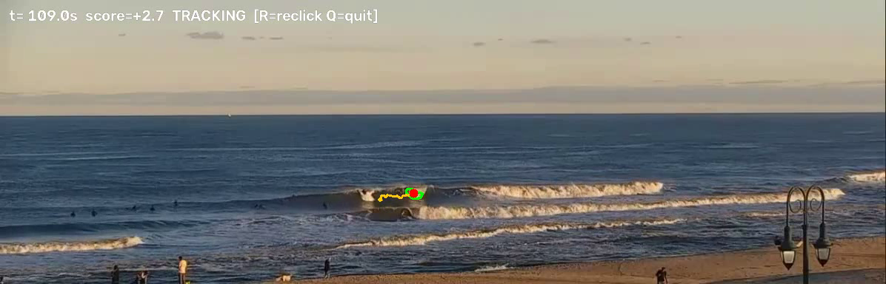

# surf_tracker

Find yourself in a Surfline cam rewind and get a clip of every wave you caught.

You screen-record the rewind, click on yourself once, and the script tracks you with
[SAM 3](https://huggingface.co/facebook/sam3) through the whole session. It writes your position
every frame, works out which stretches were rides, and cuts each one into its own short clip.



Surfers on a Surfline cam are 10 to 20 pixels tall. This works, but it is not magic: a wave hides you
for a second or two, a similar-looking surfer can steal the track, and you need to sit at the keyboard
during the run to re-click when it asks. Read [What to expect](#what-to-expect) before your first run.

## Requirements

- An **NVIDIA GPU with 4 GB or more of VRAM**. Tested on an RTX 2070 (8 GB). CPU-only runs are
  supported with `--allow-cpu` but are about 50 to 100 times slower, which makes them useless for a
  real session.
- **Python 3.11 or 3.12** on Windows, Linux or macOS. (The script has no OS-specific code; only the
  setup commands below differ.)
- A free **Hugging Face account** that has accepted the SAM 3 license. The weights are about 3.5 GB
  and download on the first run.
- **ffmpeg** on your PATH if you want the ride clips cut automatically. Everything else works without it.
- Disk: the weights plus about the size of your recording again for `annotated.mp4`.

## Install

```powershell
git clone https://github.com/colnies/surf-tracker
cd surf-tracker
py -3.12 -m venv .venv            # Linux/macOS: python3.12 -m venv .venv
.\.venv\Scripts\activate          # Linux/macOS: source .venv/bin/activate

# 1. torch with CUDA. Pick the cu* index that matches your driver (cu124 works for most 2024+ drivers).
pip install torch==2.6.0 torchvision==0.21.0 --index-url https://download.pytorch.org/whl/cu124
# 2. everything else
pip install -r requirements.txt
```

Check that torch sees your GPU before going further:

```
python -c "import torch; print(torch.cuda.is_available(), torch.cuda.get_device_name(0))"
```

Then the SAM 3 weights. Go to https://huggingface.co/facebook/sam3, click **Agree and access
repository**, and log in from the terminal:

```
hf auth login
```

ffmpeg, if you want clips: `winget install Gyan.FFmpeg` on Windows, `brew install ffmpeg` on macOS,
`sudo apt install ffmpeg` on Debian/Ubuntu. Open a new terminal afterwards so PATH is refreshed.

## Record the rewind

Surfline rewinds are streamed video, so you screen-record them. OBS works well; Xbox Game Bar
(Win+G) or QuickTime also work. Record at the player's native size and do not scale the window
during recording.

You then need the pixel rectangle of the actual video inside the recording, without the player
chrome. Open a frame of your recording in any image editor and note the top-left corner and the
width and height of the video. That becomes `--crop x,y,w,h`. Cropping tighter, to just the lineup,
helps: it makes you bigger in the model's eyes and skips the beach.

Rewinds come in segments. Record each segment separately, or join them with ffmpeg first.

## Run

```
python surf_tracker.py session.mp4 --crop 0,140,1920,800 --start 30 --out run1 --fp16
```

Use `--fp16` on an RTX 20-series card and `--bf16` on RTX 30-series or newer. Without either flag it
runs in float32, which is about three times slower.

1. A window opens on the start frame. Click on yourself and press **Enter**.
2. It tracks. Green outline is the mask, orange is your trail over the last 3 seconds, and the title
   bar shows the model's confidence score.
3. Press **R** at any time to re-click (wrong surfer, drift). Press **Q** to stop early and still get
   the results so far.
4. When a wave hides you, a yellow circle shows where it expects you to reappear. After 3 seconds of
   continuous loss it pauses and asks for a re-click. Press **S** to skip if you can't find yourself
   yet; it then stays quiet until you press **R** or the model re-acquires you confidently.

Progress and an ETA print every 100 frames.

Outputs in `run1/`:

| File | What it is |
| --- | --- |
| `track.csv` | your position, mask area and confidence for every processed frame |
| `rides.csv` | detected rides with start, end, duration and peak speed |
| `annotated.mp4` | the session with your trail drawn on it |
| `clips/ride_NN_<t>s.mp4` | each ride cut from the original recording, with `--pad` seconds either side |

## What to expect

- **Speed.** On an RTX 2070 with `--fp16` and the default `--stride 2`, expect 2 to 3 processed
  frames per second, so an 8-minute recording takes 30 to 60 minutes. In float32 it is 0.7 fps and
  takes hours. Start with `--start`/`--end` around a wave you remember to check your settings before
  committing to a full session.
- **You stay at the keyboard.** The script asks for a re-click whenever it loses you for more than
  a few seconds, which happens a handful of times per session. It cannot run unattended.
- **Track theft.** At this scale a surfer paddling past you in a similar wetsuit can take over the
  track. Watch the live window the first few runs and hit **R** when it jumps. After a wave, re-click
  on the clear surfer, not on the whitewater.
- **Tuning is normal.** Ride detection is a speed threshold. The default is set for Surfline cams at
  native resolution; if your recording is scaled, or the cam is unusually close or far, you will need
  to adjust it. See the next section. Re-running detection takes seconds and needs no GPU.

## Tuning ride detection

Detection runs on `track.csv`, so you can re-run it with new thresholds without tracking again:

```
python surf_tracker.py session.mp4 --out run1 --redetect --ride-speed 25 --min-ride 2.5 --shore down
```

- `--ride-speed` in pixels per second. Default 20. On the Belmar cam at native resolution, sitting
  and paddling are 3 to 14 px/s and a ride is 25 to 60 px/s. Open `track.csv` around a wave you know
  you caught and set this between your paddling and riding speeds. If you get false rides from
  whitewater lurches, raise it.
- `--shore` is the screen direction toward the beach: `down` for most cams. Use `any` to turn the
  direction check off. Note that most of a ride's motion is sideways along the wave; only a small
  part is shoreward, so the check is loose on purpose.
- `--min-ride` and `--merge-gap` drop short lurches and stitch a ride split by a brief tracking blip.

## All options

Run `python surf_tracker.py --help`. The ones you are most likely to touch:

| Flag | Default | Notes |
| --- | --- | --- |
| `--crop x,y,w,h` | none | video rectangle inside the recording; crop to the lineup if you can |
| `--start`, `--end` | whole file | seconds |
| `--stride` | 2 | process every Nth frame. 2 is plenty for tracking; 3 is faster |
| `--fp16` / `--bf16` | off | 2 to 3 times faster, half the VRAM. fp16 for Turing, bf16 for Ampere and newer |
| `--lost-seconds` | 3 | continuous loss before it asks for a re-click; waves hide you for 1 to 2 s routinely |
| `--min-score` | 2 | confidence below which a frame counts as lost. Real tracks score 4 to 9, wrong guesses about 0 |
| `--reacquire-radius`, `--max-speed` | 25 px, 80 px/s | after a loss you must reappear within this radius, growing at this speed |
| `--no-video`, `--no-clips` | off | skip writing `annotated.mp4` / cutting clips |

## Testing

A small regression test runs ride detection on a real `track.csv` with a known ride. It needs no
video and no GPU:

```
pip install -r requirements-dev.txt
python -m pytest tests
```

## About Surfline footage

This tool only reads screen recordings that you made on your own machine. It does not log in to
Surfline, download streams, or touch their servers in any way. Surfline rewinds are for subscribers'
personal use; keep your recordings and clips to yourself and don't commit them to a public repo
(the `.gitignore` here excludes video files for that reason).

## License

MIT for the code in this repository. SAM 3 is released by Meta under its own license, which you
accept on Hugging Face; this project does not redistribute the weights.
